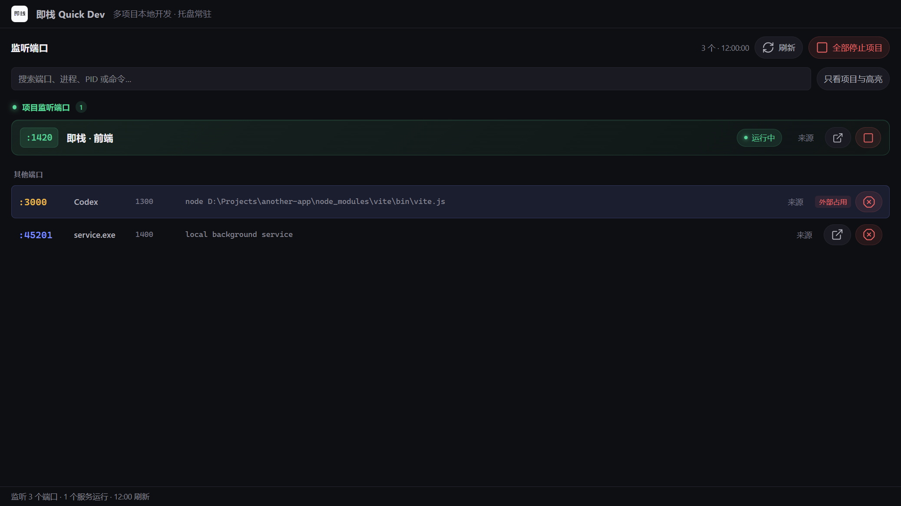
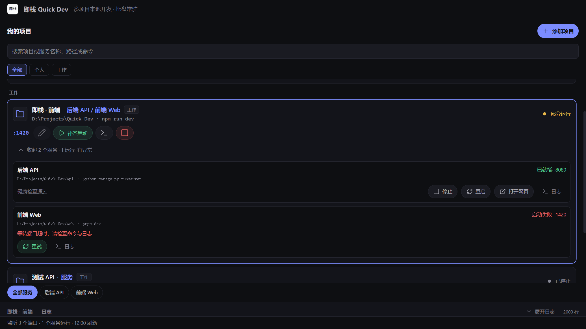
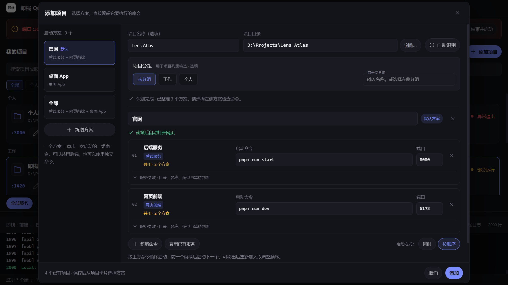
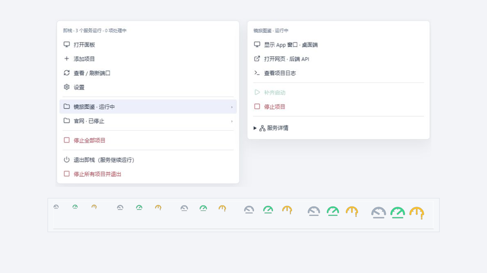

<div align="center">

# Quick Dev · 即栈

**A Windows tray app** to inspect listening ports and start/stop multiple project `dev` servers in one place.

**English** · [中文](README.md)

[](LICENSE)
[](#)
[](https://tauri.app/)
[](https://github.com/SteveC-Otaku/QuickDev/releases/latest)

</div>

---

Current version **v1.0.2** (2026-10-12 bugfix), published on GitHub Releases. Free and open source — **no project limit**. No accounts, no cloud sync. Everything stays on your machine; the app only goes online to check for updates.

Site: [quickdev.steve-lab.cc](https://quickdev.steve-lab.cc/)


## Download

Get **v1.0.2** from [GitHub Releases](https://github.com/SteveC-Otaku/QuickDev/releases/tag/v1.0.2). This release has not yet been deployed to the website:

| Installer | For |
| --- | --- |
| [`QuickDev_1.0.2_x64-setup.exe`](https://github.com/SteveC-Otaku/QuickDev/releases/download/v1.0.2/QuickDev_1.0.2_x64-setup.exe) | Most PCs (~3.3 MB) |
| [`QuickDev_1.0.2_arm64-setup.exe`](https://github.com/SteveC-Otaku/QuickDev/releases/download/v1.0.2/QuickDev_1.0.2_arm64-setup.exe) | ARM devices — Snapdragon, Surface Pro X (~3.0 MB) |

Not sure which one? Settings → System → About. If **System type** says ARM, use ARM64.

After install, open **Settings → About & updates**: the app checks for updates on launch, or you can check manually, upgrade in one click, and read the changelog.

> Windows may warn about an unknown publisher (unsigned build). Choose “Run anyway”.


## Changes in v1.0.2

- Automatically isolates standard Windows Uvicorn reload entry points in a hidden console, preventing reload signals from interrupting npm in common combined scripts.
- Preserves virtual environments, live logs and managed process ownership. Stopping a plan still reclaims the backend and reload workers; protection applies to services started by the new version.
- Leaves project files and global Python configuration untouched. Programmatic `uvicorn.run()`, disabled site/PYTHONPATH and custom reloaders are outside automatic protection.
- Passed all 53 native tests, frontend checks and business regressions, plus nine real reloads across three legacy script scenarios. ARM64 is build/file verified only, without ARM-device runtime acceptance.

See [release notes](docs/releases/1.0.2.md) and [layout and verification](docs/README.md) (Chinese).

## Features

- **Auto-detect** — pick a project folder; reads `package.json` / lockfiles / Tauri, classifies frontend / backend / desktop app, and generates Website / Desktop App / All launch plans
- **Plan start/stop** — start a whole plan, fill in missing services, stop everything; open the web URL or focus the app window when ready
- **Ports panel** — see what’s listening (process / PID / command line) and kill process trees
- **Conflict jump** — if `:3000` is taken, jump to the occupant, expand the process chain, or kill-and-start
- **Live logs** — Vite / Next output in the panel instead of a pile of console windows
- **System tray** — stays running after you close the window; native per-project menu; icon color is run state; global hotkey and optional tray-only auto-start
- **Settings & backup** — refresh interval, default tab, shell presets, groups; import / export JSON

## Screenshots









---

## Stack

- [Tauri 2](https://tauri.app/) + Rust
- SvelteKit + TypeScript + Tailwind CSS

## Development

**Requires:** Node.js 22 LTS, Rust (`rustup`), and on Windows preferably [Visual Studio Build Tools](https://visualstudio.microsoft.com/visual-cpp-build-tools/) with the C++ desktop workload. ARM64 installers also need the ARM64 MSVC toolchain.

```bash
npm install
npm run tauri dev
```

## Build installer

```bash
# current architecture
npm run tauri build

# x64 + ARM64 installers, website, and latest.json
npm run release
```

Output:

```text
src-tauri/target/<triple>/release/bundle/nsis/
release/dist/v<version>/oss/          # website + installers for OSS
release/dist/v<version>/github/       # attach to the GitHub Release
```

Windows publisher certificate signing can be skipped (`scripts/sign-windows.ps1`). v1.0.2 includes x64 / ARM64 installers with verified updater signatures and a dual-architecture manifest. ARM64 has not been runtime-tested on an ARM device.

Validation: `npm run check`, `npm test`. Native and isolated detection test instructions are in the [maintenance guide](docs/maintenance/2026-10-11-fixes/README.md).

## Config location

```text
%LOCALAPPDATA%\QuickDev\
  projects.json
  settings.json
  logs\
```

## Docs

- [PRD](PRD.md) (Chinese)
- [Features](FEATURES.md) (Chinese)
- [Tech notes](TECH.md) (Chinese)

## License

[MIT](LICENSE)
