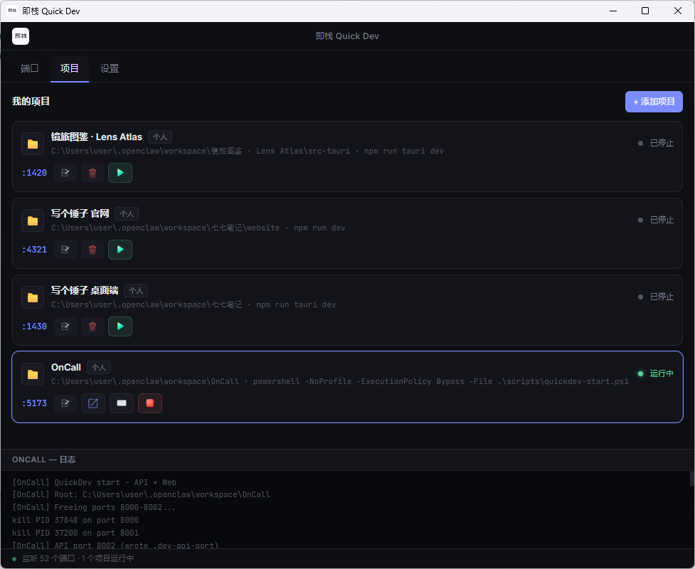

<div align="center">

# 即栈 · Quick Dev

**Windows 本地托盘工具**：看清端口占用，一键启停多个项目的 dev 服务。

[English](README.en.md) · **中文**

[](LICENSE)
[](#)
[](https://tauri.app/)
[](https://github.com/SteveC-Otaku/QuickDev/releases/latest)

</div>

---

当前版本 **v1.0.0**。完全免费开源，**不限项目数量**。不收集账号、不联网同步——数据只在你本机，仅检查更新时联网。

官网：[quickdev.steve-lab.cc](https://quickdev.steve-lab.cc/)

## 下载

到 [官网](https://quickdev.steve-lab.cc/#download) 或 [GitHub Releases](https://github.com/SteveC-Otaku/QuickDev/releases/latest) 下载 **v1.0.0**：

| 安装包 | 适用 |
| --- | --- |
| [`QuickDev_1.0.0_x64-setup.exe`](https://github.com/SteveC-Otaku/QuickDev/releases/download/v1.0.0/QuickDev_1.0.0_x64-setup.exe) | 大多数电脑（约 3.3 MB） |
| [`QuickDev_1.0.0_arm64-setup.exe`](https://github.com/SteveC-Otaku/QuickDev/releases/download/v1.0.0/QuickDev_1.0.0_arm64-setup.exe) | 骁龙 / Surface 等 ARM 设备（约 3.0 MB） |

不确定选哪个：设置 → 系统 → 系统信息，「系统类型」写着 ARM 就选 ARM64。

装好后打开 **设置 → 关于与更新**：启动时会自动检查更新，也可手动检查、一键升级，并查看更新日志。

> Windows 若提示「未知发布者」，属未代码签名，选择仍要运行即可。

## 能干什么

- **自动识别**：选项目目录，读 `package.json` / 锁文件 / Tauri 等，按前端 / 后端 / 桌面 App 分类，生成「官网」「桌面 App」「全部」启动方案
- **方案启停**：一套命令起飞；可补齐缺失服务、一键停止；成功后打开网页或聚焦窗口
- **端口面板**：谁在 Listen、进程 / PID / 命令行，一键 Kill 进程树
- **冲突跳转**：启动前发现 `:3000` 被占，可跳到占用者并展开进程链，或直接结束并启动
- **实时日志**：Vite / Next 等输出进面板，不再摊一桌黑窗
- **托盘常驻**：关窗口不退出；原生菜单按项目展开，图标颜色即运行状态；支持全局热键、开机仅托盘
- **设置与备份**：刷新间隔、默认首页、Shell 预设、项目分组；导入 / 导出 JSON

## 截图




---

## 技术栈

- [Tauri 2](https://tauri.app/) + Rust
- SvelteKit + TypeScript + Tailwind CSS

## 开发

**环境：** Node.js 18+、Rust（`rustup`）、Windows 建议安装 [Visual Studio Build Tools](https://visualstudio.microsoft.com/visual-cpp-build-tools/)（含「使用 C++ 的桌面开发」）。打 ARM64 包还需 ARM64 工具链。

```bash
npm install
npm run tauri dev
```

## 打包

```bash
# 当前架构
npm run tauri build

# x64 + ARM64 安装包、官网、latest.json
npm run release
```

安装包输出：

```text
src-tauri/target/<triple>/release/bundle/nsis/
release/dist/oss/          # 上传 OSS 的官网 + 安装包
release/dist/github/       # 挂到 GitHub Release
```

未配置代码签名时会自动跳过（见 `scripts/sign-windows.ps1`）。

## 配置目录

```text
%LOCALAPPDATA%\QuickDev\
  projects.json
  settings.json
  logs\
```

## 文档

- [产品需求 PRD](PRD.md)
- [功能说明](FEATURES.md)
- [技术方案](TECH.md)

## License

[MIT](LICENSE)
